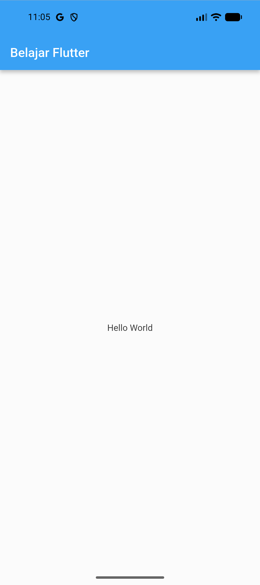
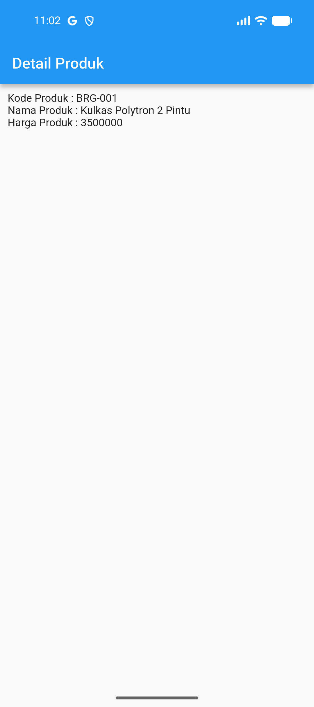
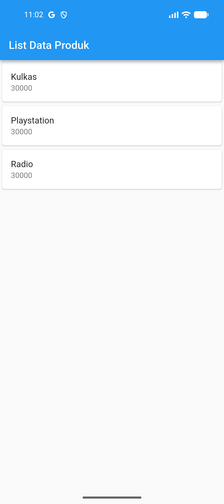

# Praktikum Pemrograman Mobile (Dart & Flutter)

Repositori ini berisi kumpulan tugas dan implementasi modul praktikum mata kuliah **Pemrograman Mobile**, mencakup dasar pemrograman **Dart** hingga pengembangan antarmuka aplikasi mobile menggunakan **Flutter Framework**.

---

## 📑 Daftar Modul Praktikum

| Modul | Topik Bahasan | Teknologi | Lokasi Direktori | Status |
| :---: | :--- | :---: | :---: | :---: |
| **Modul 1** | Struktur Data Queue (Antrian) | Dart SDK | [`queue.dart`](queue.dart) | Selesai |
| **Modul 2** | Pengenalan dan Desain Framework Flutter | Flutter & Dart | [`belajar/`](belajar/) | Selesai |

---

## 📘 MODUL 1: Struktur Data Queue (Dart)

### 📌 Konsep Queue (Antrian)
**Queue** adalah struktur data linier yang mengikuti prinsip **FIFO (First-In, First-Out)**, di mana elemen yang pertama kali dimasukkan akan menjadi elemen yang pertama kali dikeluarkan.

Operasi dasar pada Queue:
1. **Enqueue**: Menambahkan elemen ke posisi paling belakang antrian.
2. **Dequeue / Pop**: Menghapus dan mengambil elemen dari posisi paling depan antrian.
3. **Display / Tampilkan**: Melihat seluruh elemen yang berada di dalam antrian.

### 📂 Penjelasan Kode (`queue.dart`)

```dart
class Queue {
  List<int> data = [];

  // Menambahkan elemen ke dalam antrian
  void enqueue(int nilai) {
    data.add(nilai);
    print('$nilai berhasil ditambahkan ke antrian');
  }

  // Menghapus elemen paling depan
  int? pop() {
    if (data.isEmpty) {
      print('Antrian kosong');
      return null;
    }
    int nilai = data.removeAt(0);
    print('$nilai dihapus dari antrian');
    return nilai;
  }

  // Menampilkan isi antrian
  void tampilkan() {
    print('Isi antrian: $data');
  }
}

void main() {
  Queue antrian = Queue();

  antrian.enqueue(10);
  antrian.enqueue(20);
  antrian.enqueue(30);
  antrian.tampilkan();

  antrian.pop();
  antrian.tampilkan();
}
```

#### Rincian Komponen:
1. **Deklarasi Class & Properti**: `class Queue` dengan properti `List<int> data = []` sebagai wadah penampung data integer.
2. **Method `enqueue(int nilai)`**: Menggunakan `data.add(nilai)` untuk menempatkan data baru di posisi akhir antrian.
3. **Method `pop()`**: Memvalidasi kondisi antrian kosong (`data.isEmpty`), kemudian menghapus dan mengembalikan elemen pertama dengan `data.removeAt(0)` (null-safe: `int?`).
4. **Method `tampilkan()`**: Menampilkan status seluruh elemen antrian ke konsol.
5. **Fungsi `main()`**: Menjalankan simulasi penambahan data (10, 20, 30), menampilkan isi, mengeluarkan elemen pertama (10), dan menampilkan kondisi akhir.

#### 🖥️ Output Program Modul 1
```text
10 berhasil ditambahkan ke antrian
20 berhasil ditambahkan ke antrian
30 berhasil ditambahkan ke antrian
Isi antrian: [10, 20, 30]
10 dihapus dari antrian
Isi antrian: [20, 30]
```

---

## 📱 MODUL 2: Pengenalan dan Desain Framework Flutter (Aplikasi `belajar`)

### 📌 Ringkasan Modul
Modul 2 berfokus pada pengenalan ekosistem framework Flutter, dasar hierarki widget (*Widget Tree*), perancangan tata letak (*layouting*), manajemen formulir (*form input*), navigasi halaman (*routing*), serta pembuatan daftar (*ListView*).

### 📂 Struktur Direktori Proyek Modul 2
```text
belajar/
├── android/            # Konfigurasi platform native Android
├── ios/                # Konfigurasi platform native iOS
├── lib/                # Source code utama aplikasi Flutter
│   ├── ui/
│   │   ├── produk_detail.dart # Tampilan detail produk dari hasil submit form
│   │   ├── produk_form.dart   # Formulir input data produk
│   │   └── produk_page.dart   # Tampilan daftar produk (ListView & Card)
│   ├── column_widget.dart     # Demonstrasi widget Column
│   ├── hello_world.dart       # Demonstrasi StatelessWidget dasar Hello World
│   ├── main.dart              # Entry point utama aplikasi Flutter
│   └── row_widget.dart        # Demonstrasi widget Row
├── docs/
│   └── screenshots/           # Tangkapan layar hasil eksekusi semua latihan
└── pubspec.yaml               # Metadata & dependensi Flutter
```

---

### 🔍 Penjelasan Detail Kode Tiap File (Modul 2)

#### 1. Hello World (`lib/hello_world.dart`)
- **Tujuan**: Memahami struktur paling mendasar dari sebuah `StatelessWidget`.
- **Komponen Utama**:
  - `Scaffold`: Kerangka dasar antarmuka berstandar Material Design.
  - `AppBar`: Bilah header bagian atas dengan judul *"Belajar Flutter"*.
  - `Center`: Widget perata posisi yang memastikan teks berada tepat di tengah layar.
  - `Text`: Widget penampil teks statis *"Hello World"*.

#### 2. Column Widget (`lib/column_widget.dart`)
- **Tujuan**: Mempelajari pengaturan tata letak vertikal.
- **Komponen Utama**:
  - `Column`: Menampung sekumpulan widget anak (`children`) dan menyusunnya dari atas ke bawah secara berurutan (*Kolom 1, Kolom 2, Kolom 3, Kolom 4*).

#### 3. Row Widget (`lib/row_widget.dart`)
- **Tujuan**: Mempelajari pengaturan tata letak horizontal.
- **Komponen Utama**:
  - `Row`: Menampung sekumpulan widget anak (`children`) dan menyusunnya dari kiri ke kanan (*Row 1, Row 2, Row 3, Row 4*).

#### 4. Form Produk (`lib/ui/produk_form.dart`)
- **Tujuan**: Menangani masukan (*input handling*) dari pengguna secara interaktif.
- **Komponen Utama**:
  - `StatefulWidget`: Digunakan karena halaman memiliki state dinamis (isi input form yang berubah sewaktu-waktu).
  - `TextEditingController`: Tiga objek controller (`_kodeProdukController`, `_namaProdukController`, `_hargaProdukController`) untuk membaca nilai masukan teks serta membersihkan memori di `dispose()`.
  - `TextField`: Input box dengan dekorasi label *Kode Produk*, *Nama Produk*, dan *Harga*.
  - `ElevatedButton`: Tombol *"Simpan"* dengan callback `onPressed`:
    - Mengambil nilai input teks dari ketiga controller.
    - Mengonversi teks harga ke integer melalui `int.tryParse()`.
    - Melakukan navigasi layar via `Navigator.of(context).push(...)` menuju halaman `ProdukDetail` sembari mentransfer data.

#### 5. Detail Produk (`lib/ui/produk_detail.dart`)
- **Tujuan**: Memahami pengiriman data antar halaman (*passing parameters*).
- **Komponen Utama**:
  - Konstruktor berparameter: Menerima `kodeProduk`, `namaProduk`, dan `harga`.
  - `Column`: Menampilkan kembali data yang telah dikirimkan dari form produk sebelumnya dengan interpolasi string.

#### 6. List Data Produk (`lib/ui/produk_page.dart`)
- **Tujuan**: Menampilkan data kolektif dalam bentuk daftar yang rapi dan dapat digulir (*scrollable*).
- **Komponen Utama**:
  - `ListView`: Komponen daftar bergulir.
  - `Card`: Membungkus tiap item dalam kartu Material dengan elevasi dan bayangan visual.
  - `ListTile`: Format baku item daftar yang memiliki `title` (nama barang seperti *Kulkas*, *Playstation*, *Radio*) dan `subtitle` (harga barang *30000*).

#### 7. Main Entry Point (`lib/main.dart`)
- **Tujuan**: Titik masuk utama aplikasi saat pertama kali dijalankan.
- **Komponen Utama**:
  - `void main() => runApp(const MyApp())`: Menjalankan aplikasi Flutter.
  - `MaterialApp`: Mengonfigurasi judul aplikasi, tema warna Material 2 dengan AppBar biru konsisten sesuai modul, serta menetapkan `home: const ProdukPage()` sebagai halaman awal.

---

### 📸 Galeri Tangkapan Layar Tampilan Aplikasi (Modul 2)

Seluruh tangkapan layar di bawah ini diambil secara langsung dari **Android Emulator (Pixel / sdk gphone16k)**:

| No | Latihan / Fitur | File Sumber | Tangkapan Layar Emulator |
| :---: | :--- | :--- | :---: |
| 1 | **Hello World** | [`belajar/lib/hello_world.dart`](belajar/lib/hello_world.dart) |  |
| 2 | **Widget Column** | [`belajar/lib/column_widget.dart`](belajar/lib/column_widget.dart) |  |
| 3 | **Widget Row** | [`belajar/lib/row_widget.dart`](belajar/lib/row_widget.dart) |  |
| 4 | **Form Input Produk** | [`belajar/lib/ui/produk_form.dart`](belajar/lib/ui/produk_form.dart) |  |
| 5 | **Detail Produk (Data Passing)** | [`belajar/lib/ui/produk_detail.dart`](belajar/lib/ui/produk_detail.dart) |  |
| 6 | **List Data Produk (ListView)** | [`belajar/lib/ui/produk_page.dart`](belajar/lib/ui/produk_page.dart) |  |

---

## 🚀 Panduan Menjalankan Proyek

### 1. Menjalankan Program Modul 1 (Dart)
```bash
dart run queue.dart
```

### 2. Menjalankan Aplikasi Modul 2 (Flutter)
1. Buka folder proyek Flutter:
   ```bash
   cd belajar
   ```
2. Pastikan emulator atau perangkat Android terhubung:
   ```bash
   flutter devices
   ```
3. Jalankan aplikasi:
   ```bash
   flutter run
   ```

---

## 🛠️ Panduan Mengganti / Memasukkan Screenshot Manual

Jika Anda ingin memperbarui atau mengambil ulang screenshot tampilan secara manual:

1. **Menggunakan Emulator Android Studio**:
   - Jalankan aplikasi di emulator.
   - Klik ikon **Kamera (Take Screenshot)** pada bilah alat emulator di sebelah kanan.
   - Simpan gambar ke folder `docs/screenshots/` dengan nama file yang sesuai:
     - `01_hello_world.png`
     - `02_column_widget.png`
     - `03_row_widget.png`
     - `04_produk_form.png`
     - `05_produk_detail.png`
     - `06_produk_page.png`

2. **Menggunakan Terminal ADB**:
   - Jalankan perintah berikut di command prompt / terminal:
     ```bash
     adb exec-out screencap -p > docs/screenshots/06_produk_page.png
     ```

3. **Format Markdown untuk Menampilkan Gambar**:
   ```markdown
   
   ```
