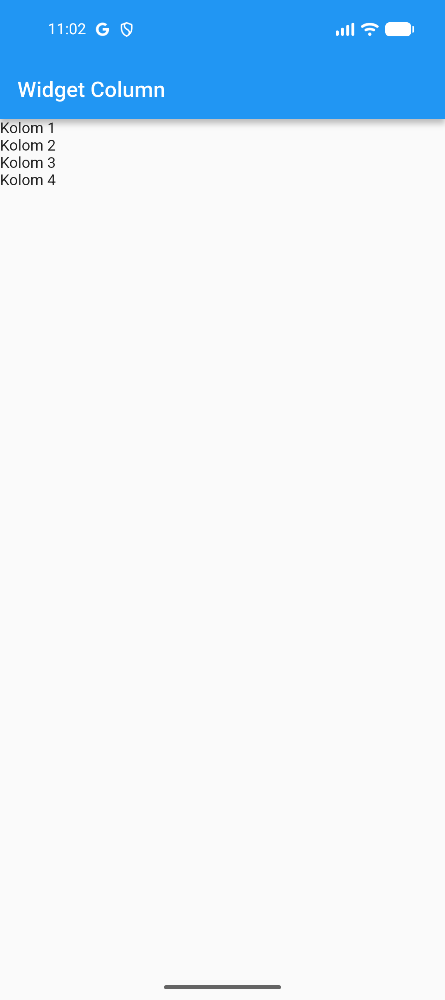
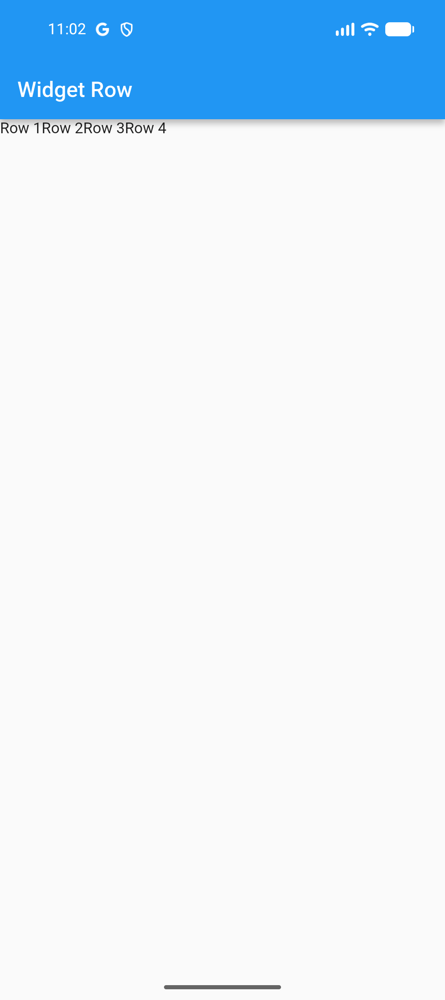
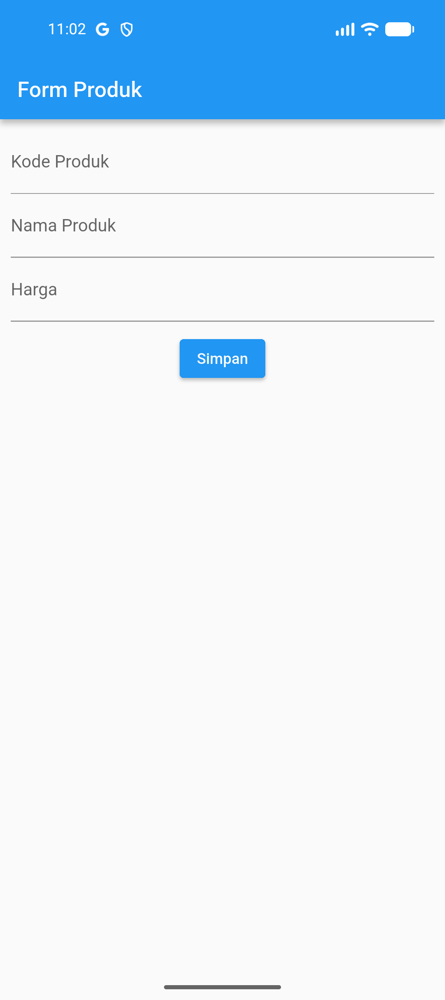
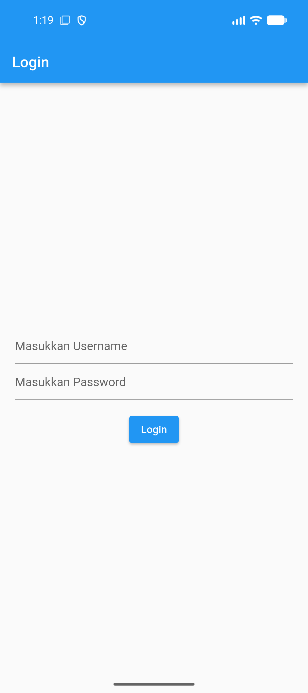
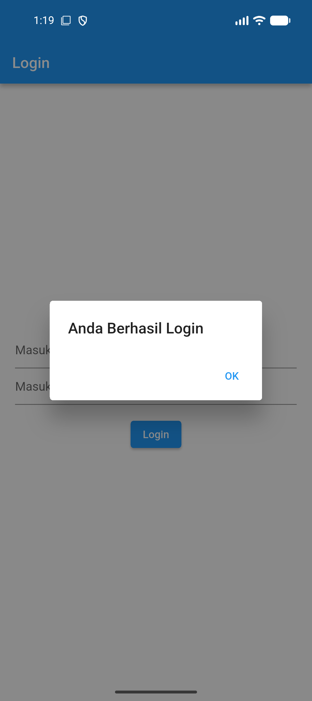
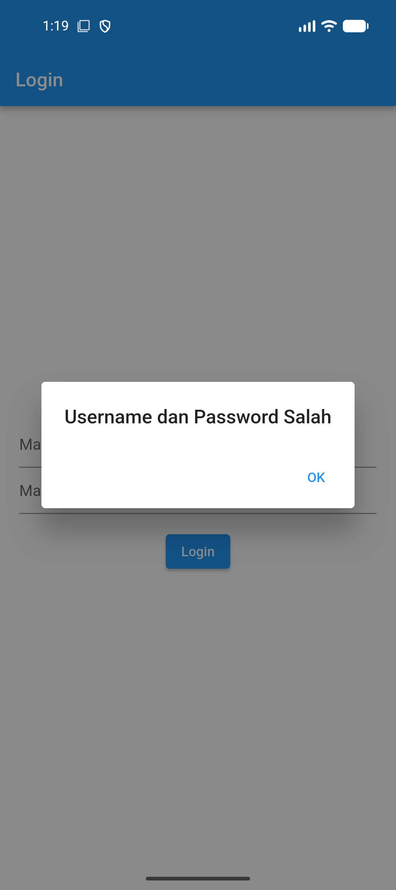
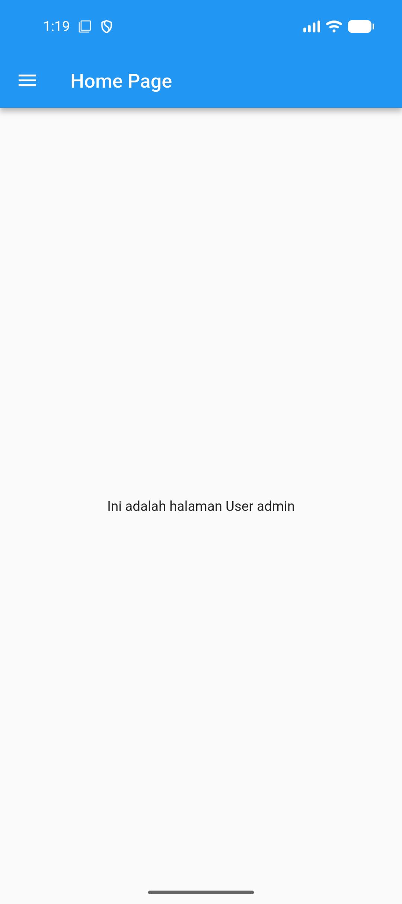
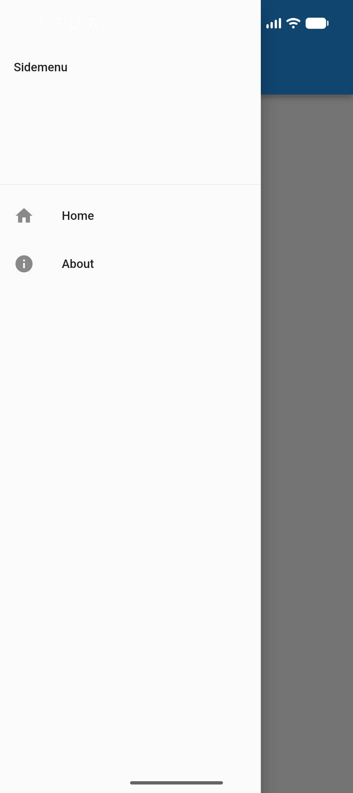
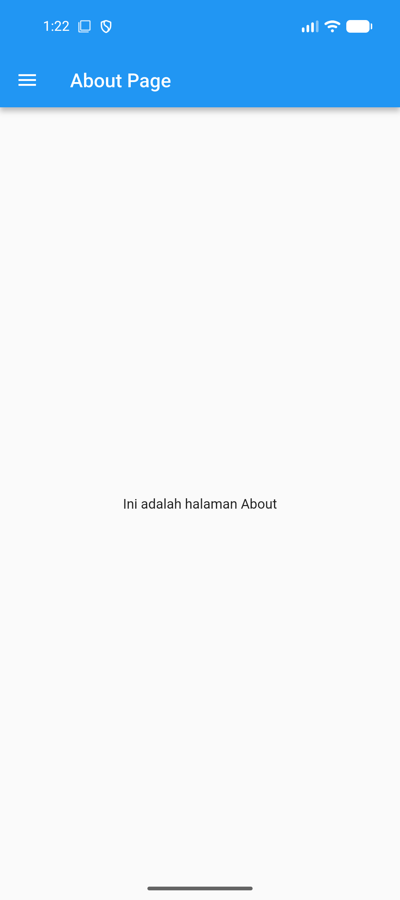

# Praktikum Pemrograman Mobile (Dart & Flutter)

Repositori ini berisi dokumentasi dan implementasi tugas praktikum mata kuliah **Pemrograman Mobile**, mencakup konsep dasar pemrograman **Dart**, dasar perancangan antarmuka **Flutter**, hingga implementasi **Autentikasi, Routing, Side Menu (Drawer), dan Local Storage**.

---

## 📑 Daftar Modul Praktikum

| Modul | Topik Bahasan | Teknologi | Lokasi Direktori | Status |
| :---: | :--- | :---: | :---: | :---: |
| **Modul 1** | Struktur Data Queue (Antrian) | Dart SDK | [`queue.dart`](queue.dart) | Selesai |
| **Modul 2** | Pengenalan dan Desain Framework Flutter | Flutter & Dart | [`belajar/`](belajar/) | Selesai |
| **Modul 3** | Routes, Side Menu, Login dan Local Storage | Flutter & SharedPreferences | [`belajar/`](belajar/) | Selesai |

---

## 📘 MODUL 1: Struktur Data Queue (Dart)

### 📌 Konsep Queue (Antrian)
**Queue** adalah struktur data linier yang mengikuti prinsip **FIFO (First-In, First-Out)**, di mana elemen yang pertama kali dimasukkan akan menjadi elemen yang pertama kali dikeluarkan.

Operasi dasar pada Queue:
1. **Enqueue**: Menambahkan elemen ke posisi paling belakang antrian.
2. **Dequeue / Pop**: Menghapus dan mengambil elemen dari posisi paling depan antrian.
3. **Display / Tampilkan**: Melihat seluruh elemen yang berada di dalam antrian.

### 📂 Penjelasan Kode (`queue.dart`)

```dart
class Queue {
  List<int> data = [];

  // Menambahkan elemen ke dalam antrian
  void enqueue(int nilai) {
    data.add(nilai);
    print('$nilai berhasil ditambahkan ke antrian');
  }

  // Menghapus elemen paling depan
  int? pop() {
    if (data.isEmpty) {
      print('Antrian kosong');
      return null;
    }
    int nilai = data.removeAt(0);
    print('$nilai dihapus dari antrian');
    return nilai;
  }

  // Menampilkan isi antrian
  void tampilkan() {
    print('Isi antrian: $data');
  }
}

void main() {
  Queue antrian = Queue();

  antrian.enqueue(10);
  antrian.enqueue(20);
  antrian.enqueue(30);
  antrian.tampilkan();

  antrian.pop();
  antrian.tampilkan();
}
```

#### 🖥️ Output Program Modul 1
```text
10 berhasil ditambahkan ke antrian
20 berhasil ditambahkan ke antrian
30 berhasil ditambahkan ke antrian
Isi antrian: [10, 20, 30]
10 dihapus dari antrian
Isi antrian: [20, 30]
```

---

## 📱 MODUL 2: Pengenalan dan Desain Framework Flutter (Aplikasi `belajar`)

### 📌 Ringkasan Modul
Modul 2 berfokus pada pengenalan ekosistem framework Flutter, dasar hierarki widget (*Widget Tree*), perancangan tata letak (*layouting*), manajemen formulir (*form input*), navigasi halaman (*routing*), serta pembuatan daftar (*ListView*).

### 📸 Galeri Tangkapan Layar Tampilan Aplikasi (Modul 2)

| No | Latihan / Fitur | File Sumber | Tangkapan Layar Emulator |
| :---: | :--- | :--- | :---: |
| 1 | **Hello World** | [`belajar/lib/hello_world.dart`](belajar/lib/hello_world.dart) |  |
| 2 | **Widget Column** | [`belajar/lib/column_widget.dart`](belajar/lib/column_widget.dart) |  |
| 3 | **Widget Row** | [`belajar/lib/row_widget.dart`](belajar/lib/row_widget.dart) |  |
| 4 | **Form Input Produk** | [`belajar/lib/ui/produk_form.dart`](belajar/lib/ui/produk_form.dart) |  |
| 5 | **Detail Produk (Data Passing)** | [`belajar/lib/ui/produk_detail.dart`](belajar/lib/ui/produk_detail.dart) |  |
| 6 | **List Data Produk (ListView)** | [`belajar/lib/ui/produk_page.dart`](belajar/lib/ui/produk_page.dart) |  |

---

## 🔐 MODUL 3: Routes, Side Menu, Login dan Local Storage

### 📌 Ringkasan Modul
Modul 3 memperluas kemampuan aplikasi dengan mengimplementasikan sistem autentikasi sederhana, penyimpanan persisten sesi pengguna (*Local Storage*) menggunakan package `shared_preferences`, penanganan dialog pop-up (`AlertDialog`), serta menu laci samping (*Side Menu / Drawer*) yang mengintegrasikan perpindahan halaman (*Routing*).

### 📂 Struktur File Modul 3
```text
belajar/
├── lib/
│   ├── about_page.dart  # Halaman informasi aplikasi dengan Sidemenu
│   ├── home_page.dart   # Halaman beranda yang membaca username dari SharedPreferences
│   ├── login_page.dart  # Halaman login yang memvalidasi & menyimpan sesi ke SharedPreferences
│   ├── main.dart        # Entry point utama aplikasi (Home: LoginPage)
│   └── sidemenu.dart    # Komponen Drawer navigasi (Home & About)
├── docs/
│   └── screenshots_modul3/ # Bukti tangkapan layar eksekusi Modul 3
└── pubspec.yaml         # Menambahkan dependencies shared_preferences
```

---

### 🔍 Penjelasan Detail Kode Tiap File (Modul 3)

#### 1. Konfigurasi Dependensi (`pubspec.yaml`)
```yaml
dependencies:
  flutter:
    sdk: flutter
  cupertino_icons: ^1.0.8
  shared_preferences: ^2.5.6
```
- Menambahkan library `shared_preferences` untuk membaca dan menulis data persisten sederhana berbasis pasangan *key-value* di penyimpanan lokal perangkat.

#### 2. Halaman Login (`lib/login_page.dart`)
- **Fungsi**: Titik awal antarmuka pengguna untuk proses autentikasi.
- **Komponen & Logika**:
  - `_usernameController` & `_passwordController`: Mengambil teks dari form input username dan password.
  - Method `_saveUsername()`: Menyimpan username ke local storage melalui `SharedPreferences.getInstance()` dan `prefs.setString('username', ...)`.
  - Method `_showInput()`: Fungsi modular untuk merender `TextField` dengan parameter controller, placeholder, dan opsi `obscureText` untuk keamanan kata sandi.
  - Method `_showDialog()`: Menampilkan jendela dialog konfirmasi status login via `AlertDialog` dan `Navigator.push`.
  - **Validasi Kredensial**:
    ```dart
    if (_usernameController.text == 'admin' && _passwordController.text == 'admin') {
      _saveUsername();
      _showDialog('Anda Berhasil Login', const HomePage());
    } else {
      _showDialog('Username dan Password Salah', const LoginPage());
    }
    ```

#### 3. Halaman Home (`lib/home_page.dart`)
- **Fungsi**: Halaman utama yang diakses setelah pengguna berhasil login.
- **Komponen & Logika**:
  - Method `_loadUsername()`: Mengambil string username yang sebelumnya telah tersimpan di SharedPreferences (`prefs.getString('username')`) dan memperbarui state dengan `setState()`.
  - Menampilkan salam penyambutan: *"Ini adalah halaman User admin"*.
  - Menghubungkan menu samping laci melalui properti `drawer: const Sidemenu()`.

#### 4. Side Menu / Drawer (`lib/sidemenu.dart`)
- **Fungsi**: Bilah menu samping yang dapat ditarik (*drawer navigation*).
- **Komponen & Logika**:
  - `Drawer` membungkus `ListView` untuk susunan item menu yang dapat digulir.
  - `DrawerHeader`: Menampilkan header bertuliskan *"Sidemenu"*.
  - `ListTile` Menu **Home**: Menampilkan ikon rumah (`Icons.home`) dan mengarahkan pengguna ke `HomePage()`.
  - `ListTile` Menu **About**: Menampilkan ikon info (`Icons.info`) dan mengarahkan pengguna ke `AboutPage()`.

#### 5. Halaman About (`lib/about_page.dart`)
- **Fungsi**: Halaman informasi pelengkap aplikasi.
- **Komponen & Logika**:
  - Menggunakan `StatelessWidget` dengan judul AppBar *"About Page"*.
  - Memiliki teks *"Ini adalah halaman About"* di tengah layar.
  - Dilengkapi `drawer: const Sidemenu()` agar pengguna dapat kembali bernavigasi ke halaman Home kapan saja.

#### 6. Entry Point (`lib/main.dart`)
- Mengarahkan alur awal aplikasi ke halaman autentikasi:
  ```dart
  MaterialApp(
    title: 'Flutter Menu',
    theme: ThemeData(
      primarySwatch: Colors.blue,
      useMaterial3: false,
      appBarTheme: const AppBarTheme(
        backgroundColor: Colors.blue,
        foregroundColor: Colors.white,
      ),
    ),
    home: const LoginPage(),
  )
  ```

---

### 📸 Galeri Tangkapan Layar Tampilan Aplikasi (Modul 3)

Seluruh tangkapan layar di bawah ini diambil secara langsung dari **Android Emulator (Pixel / sdk gphone16k)**:

| No | Fitur / Halaman | File Sumber | Tangkapan Layar Emulator |
| :---: | :--- | :--- | :---: |
| 1 | **Halaman Login** | [`belajar/lib/login_page.dart`](belajar/lib/login_page.dart) |  |
| 2 | **Alert Login Berhasil** | [`belajar/lib/login_page.dart`](belajar/lib/login_page.dart) |  |
| 3 | **Alert Login Gagal** | [`belajar/lib/login_page.dart`](belajar/lib/login_page.dart) |  |
| 4 | **Halaman Home Page (Load Local Storage)** | [`belajar/lib/home_page.dart`](belajar/lib/home_page.dart) |  |
| 5 | **Side Menu / Drawer Terbuka** | [`belajar/lib/sidemenu.dart`](belajar/lib/sidemenu.dart) |  |
| 6 | **Halaman About Page** | [`belajar/lib/about_page.dart`](belajar/lib/about_page.dart) |  |

---

## 🚀 Panduan Menjalankan Proyek

### 1. Menjalankan Modul 1 (Dart Queue)
```bash
dart run queue.dart
```

### 2. Menjalankan Aplikasi Modul 2 & 3 (Flutter)
1. Buka folder proyek Flutter:
   ```bash
   cd belajar
   ```
2. Pastikan emulator atau ponsel Android terdeteksi:
   ```bash
   flutter devices
   ```
3. Unduh dependensi:
   ```bash
   flutter pub get
   ```
4. Jalankan aplikasi:
   ```bash
   flutter run
   ```
5. **Kredensial Login**:
   - **Username**: `admin`
   - **Password**: `admin`

---

## 🛠️ Panduan Mengganti / Memasukkan Screenshot Manual

Jika Anda ingin memperbarui atau mengambil ulang screenshot tampilan secara manual:

1. **Menggunakan Emulator Android Studio**:
   - Jalankan aplikasi di emulator.
   - Klik ikon **Kamera (Take Screenshot)** pada bilah alat emulator di sebelah kanan.
   - Simpan gambar ke folder target:
     - Modul 2: `docs/screenshots/`
     - Modul 3: `docs/screenshots_modul3/`

2. **Menggunakan Terminal ADB**:
   ```bash
   # Contoh mengambil screenshot halaman login:
   adb exec-out screencap -p > docs/screenshots_modul3/01_login_page.png
   ```

3. **Format Markdown untuk Menampilkan Gambar**:
   ```markdown
   
   ```
