# Proyek Flutter: Belajar (Modul 2 & Modul 3 Pemrograman Mobile)

Proyek ini merupakan implementasi tugas praktikum mata kuliah **Pemrograman Mobile** yang memuat materi **Modul 2 (Pengenalan dan Desain Framework Flutter)** dan **Modul 3 (Routes, Side Menu, Login, dan Local Storage)**.

---

## 📑 Daftar Isi
1. [Tentang Proyek](#-tentang-proyek)
2. [Struktur Folder](#-struktur-folder)
3. [MODUL 2: Pengenalan & Desain Framework Flutter](#-modul-2-pengenalan--desain-framework-flutter)
   - [Penjelasan Kode Modul 2](#penjelasan-kode-modul-2)
   - [Galeri Tangkapan Layar Modul 2](#galeri-tangkapan-layar-modul-2)
4. [MODUL 3: Routes, Side Menu, Login & Local Storage](#-modul-3-routes-side-menu-login--local-storage)
   - [Fitur Utama Modul 3](#fitur-utama-modul-3)
   - [Penjelasan Lengkap Kode Modul 3](#penjelasan-lengkap-kode-modul-3)
   - [Galeri Tangkapan Layar Modul 3](#galeri-tangkapan-layar-modul-3)
5. [Cara Menjalankan Aplikasi](#-cara-menjalankan-aplikasi)
6. [Panduan Mengganti / Memasukkan Screenshot Manual](#-panduan-mengganti--memasukkan-screenshot-manual)

---

## 📱 Tentang Proyek
Aplikasi ini dibangun menggunakan framework **Flutter** dan bahasa pemrograman **Dart** dengan menerapkan prinsip tata letak modern, manajemen state (*StatelessWidget* dan *StatefulWidget*), penyimpanan data lokal (*Local Storage / SharedPreferences*), dialog interaktif, navigasi antar halaman (*Routing*), serta menu navigasi laci samping (*Drawer / Side Menu*).

---

## 📂 Struktur Folder
```text
belajar/
├── android/            # Konfigurasi native Android
├── ios/                # Konfigurasi native iOS
├── lib/                # Source code utama aplikasi Flutter
│   ├── ui/             # Modul 2: UI Produk
│   │   ├── produk_detail.dart # Halaman tampilan detail produk
│   │   ├── produk_form.dart   # Formulir input data produk
│   │   └── produk_page.dart   # Halaman daftar produk (ListView)
│   ├── about_page.dart        # Modul 3: Halaman About dengan Sidemenu
│   ├── column_widget.dart     # Modul 2: Latihan widget Column
│   ├── hello_world.dart       # Modul 2: Latihan widget Hello World
│   ├── home_page.dart         # Modul 3: Halaman Home Page & read local storage
│   ├── login_page.dart        # Modul 3: Halaman Login & write local storage
│   ├── main.dart              # Entry point utama aplikasi Flutter
│   ├── row_widget.dart        # Modul 2: Latihan widget Row
│   └── sidemenu.dart          # Modul 3: Komponen Drawer / Side Menu
├── docs/
│   ├── screenshots/           # Tangkapan layar Modul 2
│   └── screenshots_modul3/    # Tangkapan layar Modul 3
└── pubspec.yaml               # Metadata & dependensi (shared_preferences, cupertino_icons)
```

---

## 📘 MODUL 2: Pengenalan & Desain Framework Flutter

### Penjelasan Kode Modul 2
1. **`lib/hello_world.dart`**: Implementasi dasar `StatelessWidget` dengan `Scaffold`, `AppBar`, `Center`, dan `Text("Hello World")`.
2. **`lib/column_widget.dart`**: Implementasi widget `Column` untuk menyusun elemen secara vertikal (*Kolom 1, Kolom 2, Kolom 3, Kolom 4*).
3. **`lib/row_widget.dart`**: Implementasi widget `Row` untuk menyusun elemen secara horizontal (*Row 1, Row 2, Row 3, Row 4*).
4. **`lib/ui/produk_form.dart`**: Formulir interaktif dengan `TextEditingController` untuk input *Kode Produk*, *Nama Produk*, dan *Harga*, serta tombol simpan untuk mengirim data ke halaman detail.
5. **`lib/ui/produk_detail.dart`**: Menerima parameter melalui konstruktor dan menampilkannya kembali ke antarmuka pengguna.
6. **`lib/ui/produk_page.dart`**: Menampilkan daftar koleksi produk (*Kulkas, Playstation, Radio*) menggunakan kombinasi `ListView`, `Card`, dan `ListTile`.

### Galeri Tangkapan Layar Modul 2
| No | Latihan | Tangkapan Layar |
| :-: | :--- | :---: |
| 1 | **Hello World** (`hello_world.dart`) | 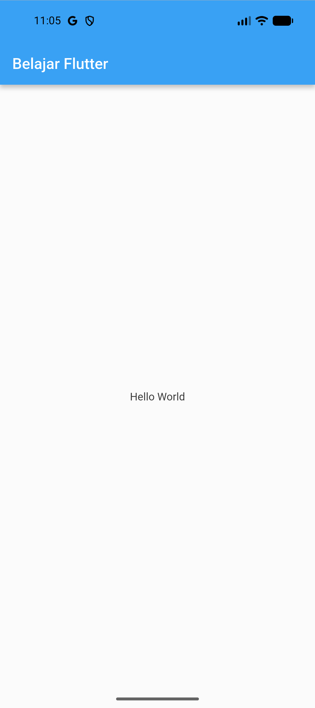 |
| 2 | **Widget Column** (`column_widget.dart`) | 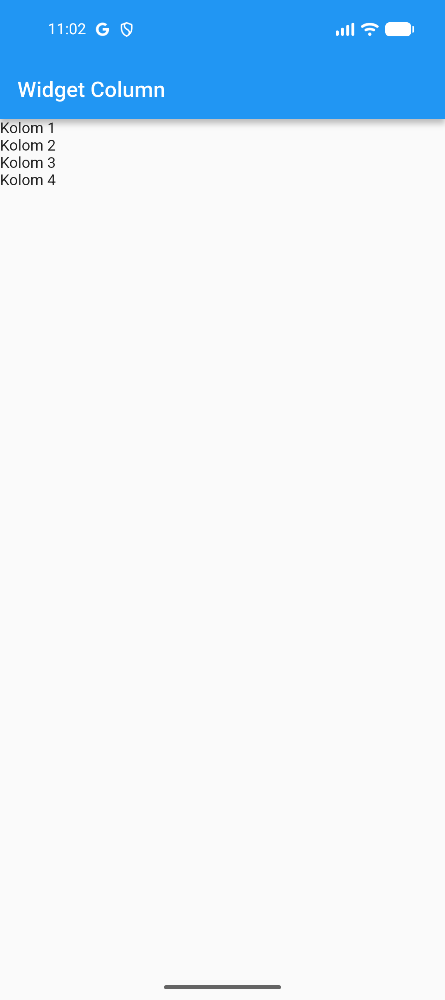 |
| 3 | **Widget Row** (`row_widget.dart`) | 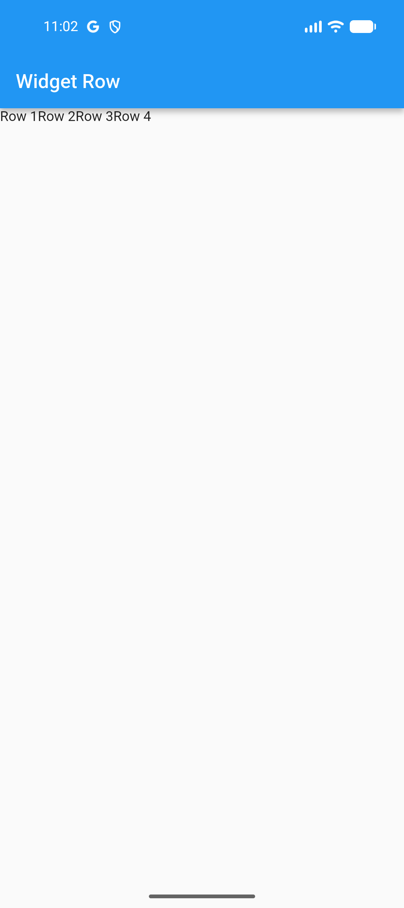 |
| 4 | **Form Input Produk** (`ui/produk_form.dart`) | 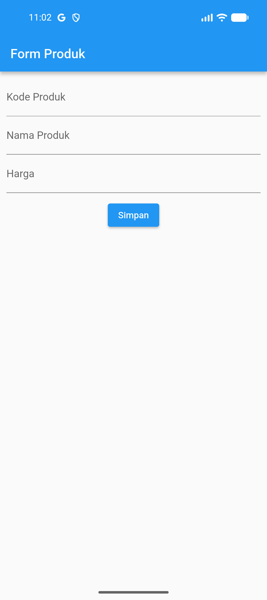 |
| 5 | **Detail Produk** (`ui/produk_detail.dart`) | 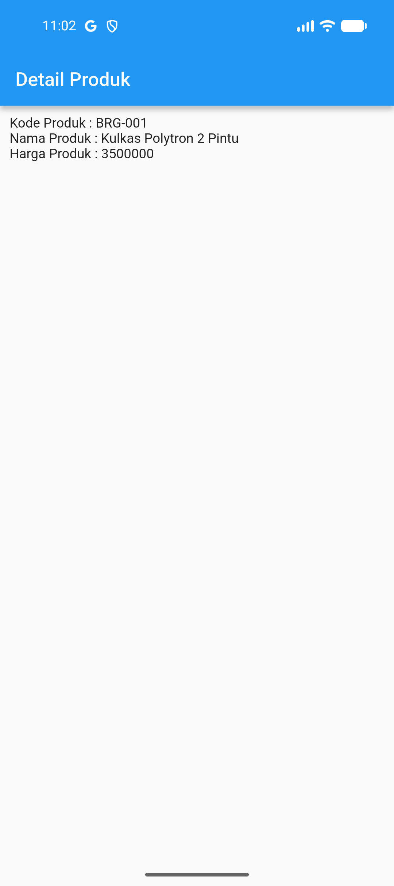 |
| 6 | **List Data Produk** (`ui/produk_page.dart`) | 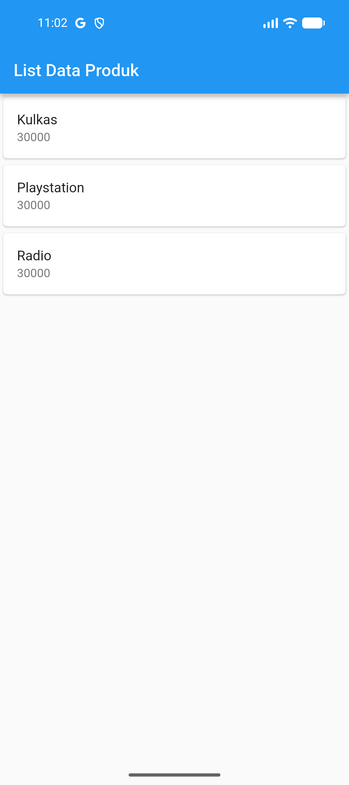 |

---

## 🔐 MODUL 3: Routes, Side Menu, Login & Local Storage

### Fitur Utama Modul 3
- **Autentikasi Pengguna**: Validasi kredensial login (Username: `admin`, Password: `admin`).
- **Local Storage (SharedPreferences)**: Menyimpan sesi nama pengguna yang berhasil login ke memori perangkat lokal secara persisten (`prefs.setString('username', ...)`).
- **Notifikasi Dialog (AlertDialog)**: Memberikan umpan balik instan apakah proses login berhasil atau gagal melalui `showDialog()`.
- **Navigasi Layar (Routing)**: Berpindah antar halaman dengan `Navigator.push()` dan `MaterialPageRoute`.
- **Side Menu (Drawer)**: Menu samping yang dapat ditarik (*drawer*) yang memuat tautan menuju halaman **Home** dan **About**.

---

### Penjelasan Lengkap Kode Modul 3

#### 1. Dependensi (`pubspec.yaml`)
```yaml
dependencies:
  flutter:
    sdk: flutter
  cupertino_icons: ^1.0.8
  shared_preferences: ^2.5.6
```
Menggunakan package `shared_preferences` untuk menyimpan data berpasangan *key-value* secara asinkron di penyimpanan persisten perangkat mobile.

#### 2. Halaman Login (`lib/login_page.dart`)
- **StatefulWidget & Controller**: Menggunakan `_usernameController` dan `_passwordController` untuk mengontrol input pengguna.
- **Method `_saveUsername()`**:
  ```dart
  void _saveUsername() async {
    SharedPreferences prefs = await SharedPreferences.getInstance();
    prefs.setString('username', _usernameController.text);
  }
  ```
  Menyimpan teks username ke dalam local storage secara asinkron.
- **Method `_showInput()`**: Fungsi pembantu (*helper*) untuk membuat `TextField` seragam dengan pengaturan `obscureText` untuk kolom sandi.
- **Method `_showDialog()`**: Menampilkan `AlertDialog` berisi pesan konfirmasi status login dan tombol navigasi aksi selanjutnya.
- **Validasi Login**:
  Jika username dan password bernilai `'admin'`, data disimpan via `_saveUsername()` dan dialog sukses diarahkan ke `HomePage()`. Jika salah, muncul dialog peringatan.

#### 3. Halaman Home (`lib/home_page.dart`)
- **Pembacaan Local Storage**:
  ```dart
  void _loadUsername() async {
    SharedPreferences prefs = await SharedPreferences.getInstance();
    setState(() {
      namauser = prefs.getString('username');
    });
  }
  ```
  Diinisialisasi pada `initState()` untuk mengambil nilai username yang telah disimpan saat login, kemudian memanggil `setState()` agar UI menampilkan: *"Ini adalah halaman User admin"*.
- **Integrasi Side Menu**: Mengaitkan properti `drawer: const Sidemenu()` pada `Scaffold`.

#### 4. Side Menu / Drawer (`lib/sidemenu.dart`)
- Membentuk komponen menu geser menggunakan `Drawer` dan `ListView`.
- Memiliki header `DrawerHeader` dengan judul *"Sidemenu"*.
- Menggunakan `ListTile` dengan ikon `Icons.home` untuk mengarahkan pengguna ke `HomePage()` dan ikon `Icons.info` untuk mengarahkan ke `AboutPage()`.

#### 5. Halaman About (`lib/about_page.dart`)
- Halaman informasi `StatelessWidget` bertajuk *"About Page"*.
- Memuat teks informasi di tengah layar (*Center*) serta dilengkapi laci menu samping (`drawer: const Sidemenu()`) agar navigasi tetap konsisten.

#### 6. Entry Point (`lib/main.dart`)
- Titik awal eksekusi yang mengarahkan `MaterialApp` dengan properti `home: const LoginPage()`.
- Menggunakan tema Material 2 dengan AppBar biru konsisten sesuai modul.

---

### 📸 Galeri Tangkapan Layar Modul 3

Hasil tangkapan layar langsung dari **Android Emulator (sdk gphone16k)**:

| No | Fitur / Halaman | File Sumber | Tangkapan Layar Emulator |
| :-: | :--- | :--- | :---: |
| 1 | **Halaman Login** | [`lib/login_page.dart`](lib/login_page.dart) | 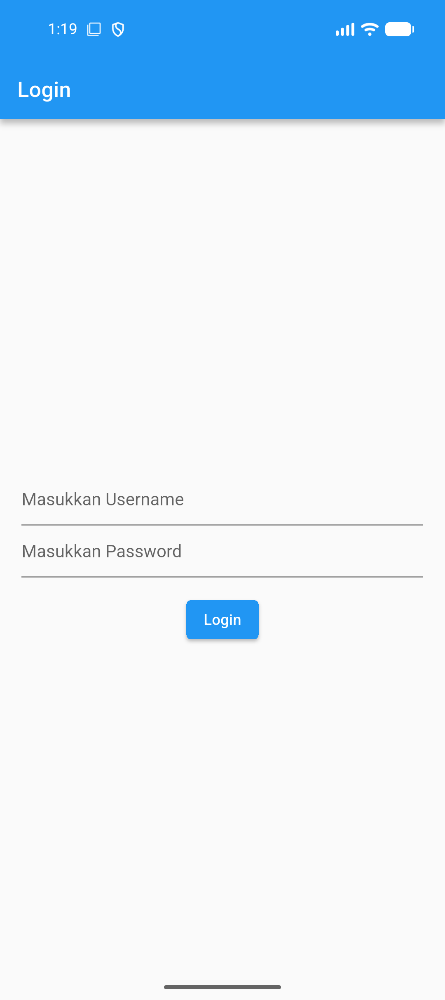 |
| 2 | **Alert Login Berhasil** | [`lib/login_page.dart`](lib/login_page.dart) | 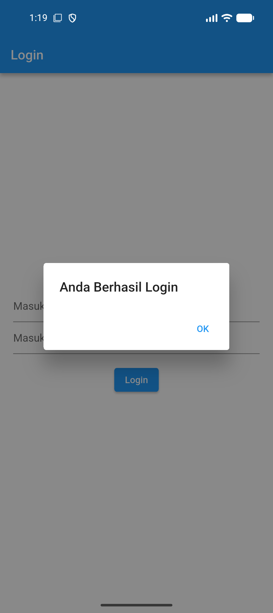 |
| 3 | **Alert Login Gagal** | [`lib/login_page.dart`](lib/login_page.dart) | 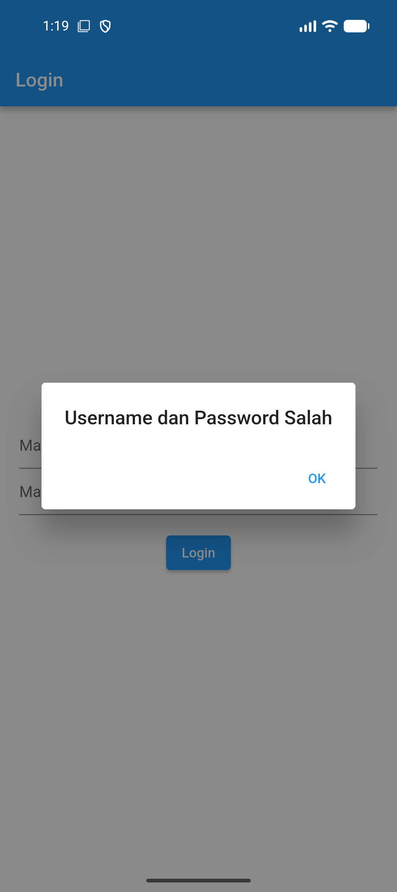 |
| 4 | **Halaman Home Page (Load Local Storage)** | [`lib/home_page.dart`](lib/home_page.dart) | 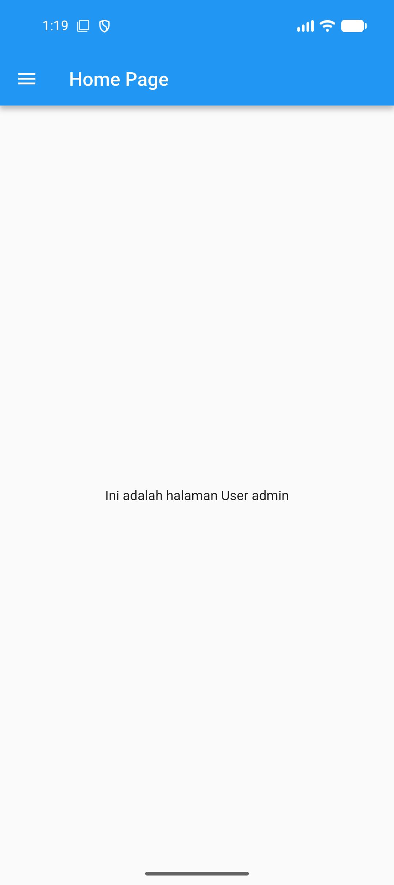 |
| 5 | **Side Menu / Drawer Terbuka** | [`lib/sidemenu.dart`](lib/sidemenu.dart) | 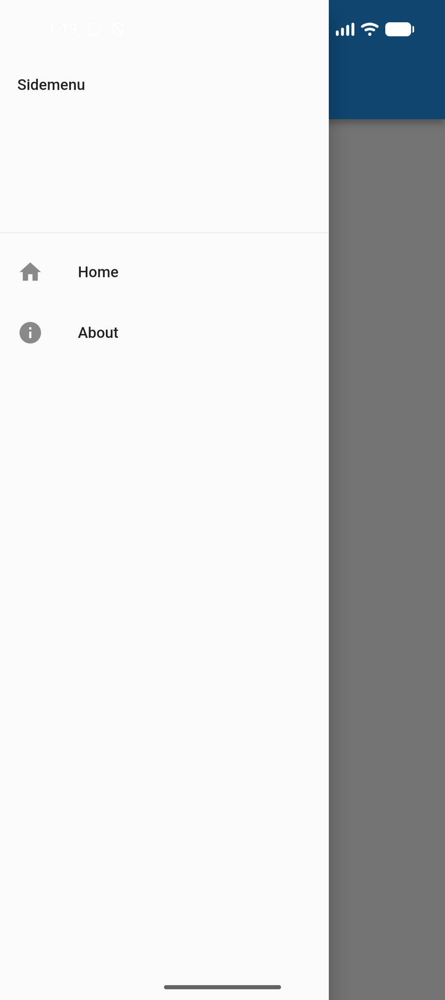 |
| 6 | **Halaman About Page** | [`lib/about_page.dart`](lib/about_page.dart) | 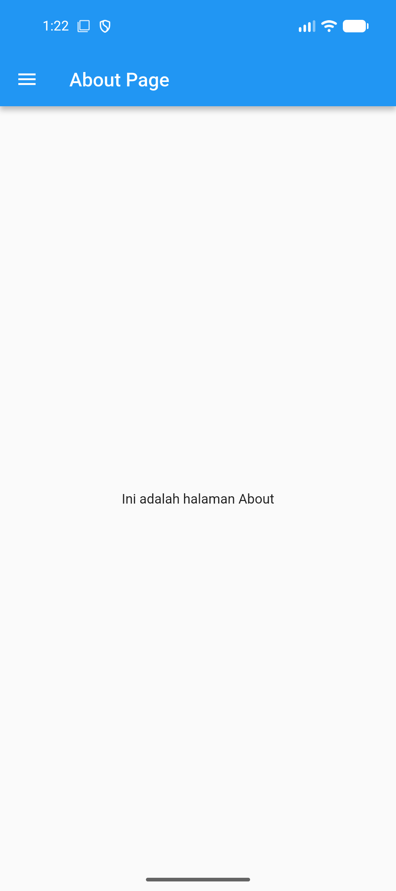 |

---

## 🚀 Cara Menjalankan Aplikasi

1. **Jalankan Aplikasi Flutter**:
   ```bash
   cd "d:/belajar"
   flutter run
   ```

2. **Kredensial Login Demo**:
   - **Username**: `admin`
   - **Password**: `admin`

---

## 🛠️ Panduan Mengganti / Memasukkan Screenshot Manual

Jika Anda ingin memperbarui screenshot secara manual di kemudian hari:

1. **Menggunakan Android Studio Emulator**:
   - Buka bilah alat di sebelah kanan emulator.
   - Klik ikon **Kamera (Take Screenshot)**.
   - Simpan gambar ke folder target:
     - Modul 2: `docs/screenshots/`
     - Modul 3: `docs/screenshots_modul3/`
2. **Menggunakan Terminal ADB**:
   ```bash
   adb exec-out screencap -p > docs/screenshots_modul3/nama_file.png
   ```
3. **Format Markdown untuk Gambar**:
   ```html
   
   ```
